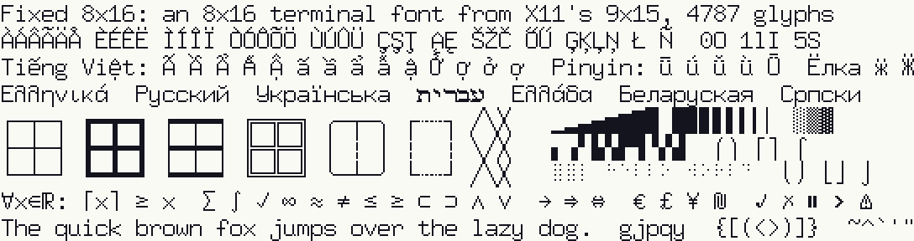

# Fixed 8x16

An 8×16 bitmap terminal font in BDF, covering 4,791 characters of Unicode's
Basic Multilingual Plane. It is X11's `misc-fixed` 9x15 redrawn for 8-pixel
cells, with a line more above the capitals so that accents never squash the
letter under them.



```
FONT -Fructus-Fixed-Medium-R-Normal--16-150-75-75-C-80-ISO10646-1
```

Ascent 13, descent 3. Capitals are 10 pixels tall and the x-height is 7.

## Where it comes from

The font started as the character set of the terminal in
[Fructus](https://github.com/erikcorry/fructus), a home-made CPU with a VGA
display: 80×28 characters of 8×17 pixels in 640×480. That terminal draws its
characters from X11's 9x15, the `misc-fixed` font by Markus Kuhn and others,
but it cannot use 9x15 as it is:

- its glyphs are 9 pixels wide, not 8, and
- its accented capitals are squashed to fit their accents inside the cell.

So the terminal's `gen-font.mjs` cuts each glyph to 8 columns. It also builds
accented letters from a base and a mark, with the marks over capitals in 3
lines of their own above the letter. This BDF is that font, written out by
`node terminal/gen-font.mjs --bdf fixed-8x16.bdf`, minus the cell's
seventeenth line, which only box drawing and blocks reach. Everything the
terminal has no room for is filled in from 9x15.

Each glyph comes from the first of these that has it:

| Source | Glyphs | What |
|---|---|---|
| Drawn for the cell | 160 | All of box drawing and block elements, U+2500–U+259F |
| The terminal's font | 1,145 | ASCII, Latin, Greek, Cyrillic, Hebrew, symbols, Braille, as the terminal shows them |
| Stacked | 157 | Letters with marks the terminal cannot show, on its own unsquashed letters |
| Persian | 6 | ی and ژ, which 9x15 lacks, and their forms, from 9x15's letters |
| 9x15 | 3,319 | Everything else 9x15 has, made 8 wide |
| The terminal's aliases | 4 | Characters 9x15 lacks, drawn as a lookalike |

## Coverage

Everything in 9x15 is here, and 15 characters more. Four of them are
letters a language needs:

- **ӏ**, the small palochka, in the alphabets of Adyghe, Chechen and
  Kabardian (CLDR's exemplar letters). 9x15 has only the capital Ӏ.
- **Ʌ**, the capital of ʌ, for Mohawk. 9x15 has only the small ʌ.
- **ی and ژ**, the two letters of the Persian alphabet that 9x15 lacks,
  with ژ's isolated and final forms. ی is drawn as ى, and ژ is ز with ش's
  three dots. 9x15's isolated and final ی, U+FBFC and U+FBFD, have the two
  dots that Persian's ی has only at the start and in the middle of a word;
  here they have none.

The rest are ȷ (dotless j), 〈 〉, and ⏵ ⏸ ⏺ ⚠ ❯ ⧉. Every other language
reads in this font only where it reads in 9x15. What differs is how its
letters look, below.

The other languages written in the Arabic script - Urdu, Pashto, Sindhi,
Sorani Kurdish, Uyghur, Kashmiri - still lack letters (ٹ ڈ ڑ ں ہ ے, ځ څ
ډ ښ ګ ڼ, ڻ ڳ ڪ, ڕ ڵ ێ ۆ, ۇ ۈ ۋ ڭ ...), as they do in 9x15.

## Features

- **Accented capitals at full height.** Á Ö Ç Ş Ő Ů, and the Greek and Cyrillic
  Ё Ї Ќ, keep the capital's 10 lines, with the accent in the three lines above
  it. 9x15 shortens these capitals by two or three lines.
- **One set of accents.** Every accented letter is drawn from the same marks,
  so ä and Ä and ӝ have the same diaeresis. The marks below are the cedilla,
  the ogonek and the comma, dot and macron below. Latvian's ģ ķ ļ ņ have a
  comma below, as Latvian type does.
- **Two marks.** Vietnamese's ấ ầ ẩ ẫ ậ ắ ế ố ớ ợ ừ ... take 9x15's pair of
  marks, side by side as Vietnamese sets them, over the font's full-height
  letter: Ấ is a full A with its marks above. Pinyin's ǖ ǘ ǚ ǜ and other
  letters with two marks are stacked the same way.
- **Udmurt's, Mari's and others' Cyrillic letters** with a diaeresis or a
  breve (ӝ ӟ ӥ ӧ ӱ ӵ ...) are their base letter with the font's own mark.
- **A dotted zero**, unlike O.
- **Box drawing that joins**, all 128 characters: light, heavy, double,
  rounded, dashed, light and heavy mixed, half lines and diagonals. Lines are
  centred on column 4 and line 8 and reach the cell's edges, so frames and
  trees join across cells. Dashes end with a gap, so they are spaced evenly
  from cell to cell.
- **Blocks at exact steps**, all 32: the lower eighths are 2, 4, 6 ... 16
  lines, and the left eighths 1 to 8 columns, plus the quadrants and shades.
- **Braille in letter-sized cells.** The 256 patterns are one pixel a dot, in
  columns 2 and 5 and on lines 2, 5, 8 and 11. That leaves a gap between
  cells, so Braille text reads as separate letters rather than a field of
  dots, and graphs drawn in Braille still show their shape.
- **Connectors that meet.** ⌠ ⌡ and 9x15's bracket pieces ⎛⎜⎝ ⎡⎢⎣ ⎧⎨⎩⎪ reach
  the cell's top and bottom, so tall brackets and integrals stack.
- **Hebrew** with the maqaf at the top of the letters, where it joins them,
  and Yiddish's ligatures and pointed letters.
- **The symbols Claude Code draws**: ⏺ ⎿ ❯ ⏸ ⚠ ⧉ ✓ ✗ and its spinner's stars.

## Limitations

- **9x15's glyphs are cut to 8 columns.** A blank column goes, or failing
  that one the same as its neighbour, usually the middle of a stroke. 361
  glyphs that have ink in every column lose their right-hand one instead, so
  they are cramped or clipped: mostly Ethiopic, Arabic, circled and
  parenthesised numbers and letters (① ⑴ Ⓐ), Greek capitals with breathing
  and accent, and some wide symbols and arrows.
- **The rest of 9x15 keeps its style**, squashed capitals and all, wherever
  the font has no letter of its own to put the marks on. That covers
  polytonic Greek, capitals whose two marks need more than three lines (Ǘ Ǚ Ǜ
  Ǻ Ẫ Ẵ Ễ Ỗ), Vietnamese's horned letters with a dot below (Ợ ợ Ự ự), and
  letters with marks below the terminal does not have (ḁ ḓ ṱ ...).
- **No wide characters.** There is no CJK, nothing needs two cells, and
  nothing is beyond U+FFFF.
- **Combining marks are 9x15's** (U+0300–U+036F and the rest), each in a
  cell of its own, drawn at the height of a small letter's accent. A
  terminal that overstrikes them puts them over capitals' tops.
- **One weight.** There is no bold; terminals embolden by overstriking.
- **Box drawing is a line off centre** vertically. Its middle is line 8, with
  8 lines above it and 7 below, since 16 lines have no middle line.
- **Braille dots are single pixels**, so Braille is lighter than text.

## Using it

As an X11 font:

```
bdftopcf -o fixed-8x16.pcf fixed-8x16.bdf
mkfontdir .
xset +fp "$PWD" && xset fp rehash
xterm -fn -fructus-fixed-medium-r-normal--16-150-75-75-c-80-iso10646-1
```

The BDF can also be converted for other systems, for example with `bdf2psf`
for the Linux console (which takes at most 512 glyphs), or with FontForge.

## Licence

Public domain, like the 9x15 it comes from.
